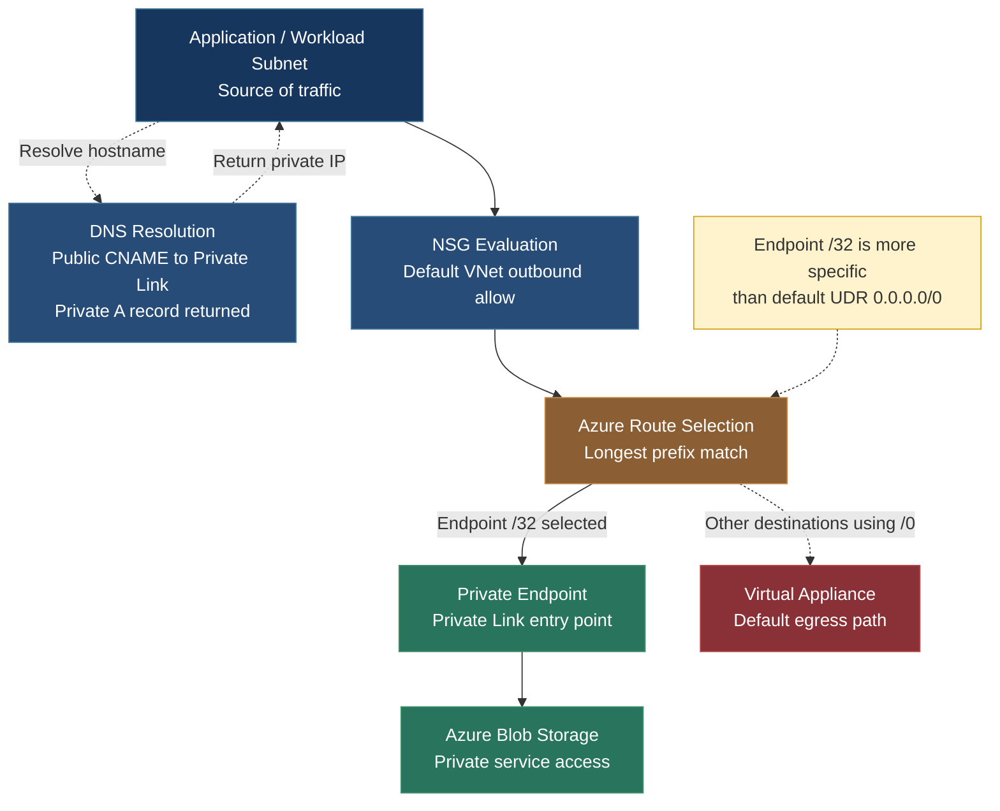

# Network Like an Operative
### Azure Network Traffic Analysis | Private Endpoint Connectivity Investigation

**Investigation Type:** Network Trace / Technical Ticket Response  
**Platform:** Microsoft Azure  
**Access Level:** Reader (Read-Only)  
**Focus:** Network Security Groups, User-Defined Routes, Private Endpoints, Private DNS, and Traffic Routing

---

## 1. The Ticket

> **Application Team:** "Our new service can reach the customer-data storage account, but I don't understand why or how. Can someone walk me through the network path?"

**Objective:** Trace the application's network path from its workload subnet to an Azure Storage account and explain how connectivity is possible despite a forced-egress route and disabled public access.

The investigation examines five configuration layers to determine how the application resolves, routes, and reaches the storage service.

---

## 2. The Network Trace

### Hop 1: The VNet — Identifying the Source

**What I checked:**

I reviewed the virtual network `vnet-lab-chap5` and inspected its configured subnets to figure out the source network and identify the security and routing controls that belong to it.

**What I found:**

The VNet contains two subnets:

| Subnet | Address Range | Purpose |
|---|---|---|
| snet-workload | 10.60.1.0/24 | Application workload |
| snet-appliance | 10.60.100.0/24 | Virtual network appliance |

The `snet-workload` subnet has two resources:

- Network Security Group: `nsg-lab-workload`
- Route Table: `rt-lab-workload`

**What this means:**

The workload subnet provides the starting point for the traffic investigation. Its associated NSG and route table establish the network controls that must be evaluated to understand the application's connectivity.

**Evidence:**

<i>Figure 1. Azure VNet subnet configuration showing the workload and appliance subnets, their IPv4 address ranges, and the security and route table associations.</i>

---

### Hop 2: The NSG — Evaluating Traffic Restrictions

**What I checked:**

I examined `nsg-lab-workload` to identify the security rules governing traffic entering and leaving the workload subnet.

**What I found:**

The NSG contains two custom inbound rules:

| Priority | Rule | Source | Port | Action |
|---|---|---|---|---|
| 310 | allow-vpn-https | 203.0.113.50 | TCP 443 | Allow |
| 4000 | deny-inbound-default | Internet | Any | Deny |

The first rule permits HTTPS traffic from one specified source address.

The second rule denies inbound traffic matching the `Internet` source service tag.

The NSG also retains Azure's default security rules, including `AllowVnetInBound` and `AllowVnetOutBound`.

There are no custom outbound security rules configured.

**What this means:**

The custom inbound rules restrict access from the specified source categories, while the default outbound rules permit matching traffic within the virtual network.

The inbound deny rule does not represent a universal denial of every inbound source because its source is specifically the `Internet` service tag.

The workload's connection to the private endpoint can therefore be permitted by the NSG's default outbound VNet rule.

**Evidence:**

<i>Figure 2. NSG configuration showing the custom inbound allow and deny rules, their priorities, and the absence of custom outbound rules.</i>

---

### Hop 3: The Route — Investigating Forced Egress

**What I checked:**

I reviewed `rt-lab-workload` to determine how outbound traffic from the workload subnet is routed and which device is designated as its next hop.

**What I found:**

The route table contains one user-defined route:

| Configuration | Value |
|---|---|
| Route Name | force-egress |
| Destination Prefix | 0.0.0.0/0 |
| Next Hop Type | Virtual appliance |
| Next Hop IP | 10.60.100.4 |
| Associated Subnet | snet-workload |

The default route forwards matching outbound destinations to a virtual appliance.

However, the Azure private endpoint design introduces a more-specific host route for the private endpoint address.

**What this means:**

A `0.0.0.0/0` route matches every IPv4 destination, but it is the least specific possible IPv4 prefix.

Azure uses longest-prefix matching to select a route. A private endpoint `/32` host route is more specific than the `/0` default route and therefore takes precedence when both are applicable.

For this lab, that explains why traffic to the private endpoint can follow a direct private route instead of the default path through the virtual appliance.

**Important:** The screenshot confirms the configured UDR. The selected effective route was not independently verified through workload NIC effective routes or packet capture.

**Evidence:**

<i>Figure 3. User-defined route force-egress directing default IPv4 traffic to virtual appliance 10.60.100.4, with the workload subnet association visible.</i>

---

### Hop 4: The Private Endpoint — Establishing Private Connectivity

**What I checked:**

I inspected the DNS configuration of the private endpoint `pe-lab-storage` to determine how the storage service is represented inside the virtual network.

**What I found:**

The private endpoint configuration identifies:

| Property | Value |
|---|---|
| Private Endpoint | pe-lab-storage |
| Private IP | 10.60.1.62 |
| Storage FQDN | stmadhatlabchap5.blob.core.windows.net |
| Private DNS Zone | privatelink.blob.core.windows.net |

The assigned address `10.60.1.62` belongs to the `10.60.1.0/24` workload subnet.

The endpoint provides a private network interface through which resources in the VNet can access the Azure Blob Storage service using Private Link.

**What this means:**

The storage account does not need to expose a public endpoint for the application to connect through an approved private endpoint.

The private endpoint serves as the private network entry point to the storage service, while Azure Private Link provides connectivity over Microsoft's network infrastructure.

The lab scenario states that public network access is disabled. This specific setting was not independently captured in the screenshots.

**Evidence:**

<i>Figure 4. Private endpoint DNS configuration correlating the storage service FQDN with its assigned private address, 10.60.1.62.</i>

---

### Hop 5: The Name — Resolving the Private Address

**What I checked:**

I inspected the record sets associated with the private DNS zone `privatelink.blob.core.windows.net` to determine how the storage hostname resolves to its private endpoint address.

**What I found:**

The DNS zone contains the following A record:

| Record Name | Record Type | IP Address | TTL |
|---|---|---|---|
| stmadhatlabchap5 | A | 10.60.1.62 | 10 seconds |

The record matches the private IP address assigned to `pe-lab-storage`.

**What this means:**

The application can request the storage account using its standard hostname rather than hardcoding an IP address.

Azure's storage DNS configuration uses the public storage hostname and its Private Link alias. When the private DNS zone is properly linked or accessible through DNS forwarding, the lookup returns the private endpoint address.

This allows the application to discover the private network destination dynamically.

The matching DNS record and endpoint configuration support the intended resolution path. A DNS query executed from the workload would independently confirm the actual result.

**Evidence:**

<i>Figure 5. Private DNS zone A record mapping the storage account name to the private endpoint address 10.60.1.62.</i>

---

## 3. Network Traffic Visualization

The following diagram illustrates the application's expected connection path and the relevant network controls.

<i>Figure 6. Logical network traffic flow showing DNS resolution, NSG evaluation, route selection, and private endpoint access. DNS is a preliminary lookup, not a data-plane hop. The virtual appliance represents the alternative default route.</i>

---

## 4. Key Finding — Longest Prefix Matching

The most important discovery was understanding why a forced-egress route does not necessarily guarantee that every outbound packet passes through the network appliance.

Consider the following two routes:

| Route | Prefix | Routing Function |
|---|---|---|
| Default UDR | 0.0.0.0/0 | Sends matching traffic through the virtual appliance |
| Private Endpoint Host Route | 10.60.1.62/32 | Identifies one specific destination |

Azure prioritizes the longest matching address prefix.

A `/32` matches one IPv4 address, whereas a `/0` matches every IPv4 address.

Therefore, when both routes apply to traffic destined for `10.60.1.62`, the `/32` route takes precedence.

**Investigation takeaway:**

A forced-tunnel default route should not be interpreted as proof that all outbound traffic undergoes firewall inspection.

Route specificity and private endpoint network policies must also be considered.

---

## 5. The Answer — Reply to the Application Team

> **To: Application Team**
>
> **Subject: Storage Connectivity Investigation — Network Path Explained**
>
> I reviewed the application's Azure network configuration and identified how the service can reach the storage account using private connectivity.
>
> The application uses the storage account's standard hostname, which resolves through the configured Private Link DNS path to the private endpoint address `10.60.1.62`.
>
> The endpoint is located within the workload subnet's address range. The associated NSG contains no custom outbound restrictions, and its default VNet outbound rule permits matching private traffic.
>
> Although the workload subnet has a default route through virtual appliance `10.60.100.4`, Azure's more-specific private endpoint host route takes precedence over the `0.0.0.0/0` forced-egress route.
>
> Consequently, the application can use Azure Private Link to reach the storage service without relying on the storage account's public endpoint.
>
> This explains the connectivity reported in the ticket. The analysis is based on the existing Azure configuration; confirming the active route and inspection behavior would require additional validation.

---

## 6. What I Would Flag

**Potential security concern:**

The private endpoint routing configuration may allow storage-bound traffic to bypass the virtual appliance's normal inspection path.

I would recommend confirming with the network security team whether this routing behavior is intentional and whether alternative inspection or monitoring controls are in place.

Before closing a similar production ticket, I would also verify the effective route, DNS resolution from the workload, private endpoint approval status, and any additional security controls.

No configuration changes were performed during this investigation.

---

## 7. What I Learned

**Lesson 1 — Routing depends on prefix specificity.**

[Describe how your understanding of the /32 private endpoint route changed your interpretation of the /0 forced-egress UDR.]

**Lesson 2 — Network connectivity requires multiple layers to work together.**

[Explain what you learned about the relationship between DNS, NSGs, routing, and private endpoints.]

### What Surprised Me

[Describe the most unexpected aspect of the investigation and why the observed configuration challenged your initial assumptions.]

---

## 8. Investigation Outcome

The investigation produced a configuration-based explanation of the application's private storage connectivity using read-only access.

**Skills demonstrated:**

- Azure Virtual Network and subnet analysis
- Network Security Group rule interpretation
- User-defined route evaluation
- Longest-prefix routing analysis
- Azure Private Endpoint and Private Link inspection
- Private DNS record correlation
- Security configuration analysis using Reader access
- Technical documentation and cross-team communication

**Investigation limitation:** This was a configuration trace, not a packet capture or a verified production traffic test.

---

## 9. References

- [Microsoft Learn — Azure Virtual Network Traffic Routing](https://learn.microsoft.com/en-us/azure/virtual-network/virtual-networks-udr-overview)
- [Microsoft Learn — Network Security Groups](https://learn.microsoft.com/en-us/azure/virtual-network/network-security-groups-overview)
- [Microsoft Learn — Azure Private Endpoint DNS Configuration](https://learn.microsoft.com/en-us/azure/private-link/private-endpoint-dns)
- [Microsoft Learn — Azure Storage Private Endpoints](https://learn.microsoft.com/en-us/azure/storage/common/storage-private-endpoints)
- [Microsoft Learn — Private Endpoint Network Policies](https://learn.microsoft.com/en-us/azure/private-link/disable-private-endpoint-network-policy)
- Mad Hat Labs — Network Like an Operative, Chapter 5 Lab
