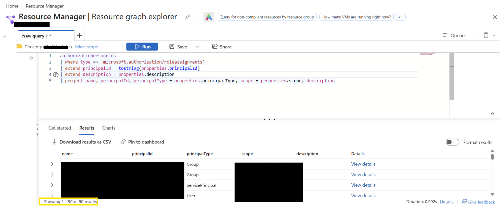
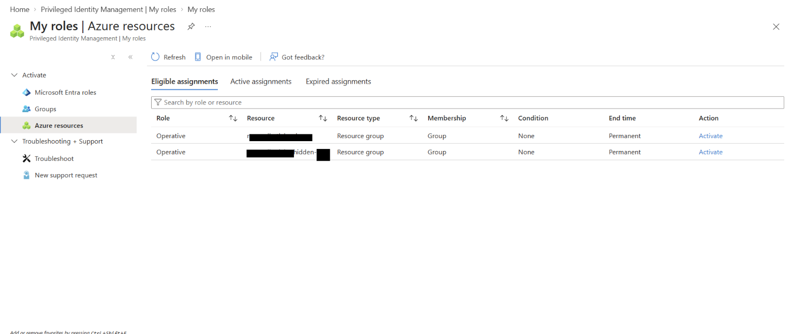
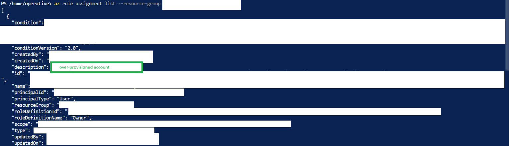

# The Privilege Audit
### Azure RBAC | Identity & Access Management | Security Governance

> [!IMPORTANT]
> **[ CLASSIFIED // AUDIT BRIEFING ]**
>
> **CASE:** THE PRIVILEGE AUDIT  
> **TENANT:** Mad Hat Labs  
> **STATUS:** FIELD AUDIT COMPLETE  
> **CLEARANCE:** OPERATIVE (Reader)  
>
> **OBJECTIVE:** Walk through the privilege access audit. Recover the security team's finding at each stage. Confirm the culprit.

---

## 1. Executive Summary

I conducted a privilege access audit within the Mad Hat Labs Azure environment to evaluate role-based access control (RBAC) assignments, identify potential security risks, and assess the effectiveness of different auditing methods.

Unlike an incident investigation, which reconstructs a security event, this audit focused on evaluating the existing access control configuration and identifying weaknesses in identity and access management (IAM).

The assessment focused on three primary security concerns:

- **Orphaned role assignments:** Permissions associated with deleted or unresolved security principals.
- **Excessive privileges:** Repeated Owner assignments across resource scopes.
- **Standing privileged access:** Administrative access that could benefit from Privileged Identity Management (PIM).

I used four auditing methods: Azure Portal IAM, Azure CLI, Azure Resource Graph with KQL, and Microsoft Entra Privileged Identity Management.

Each method offered different visibility into the environment, demonstrating why a comprehensive privilege audit requires multiple tools.

---

## 2. Scope and Methodology

**Environment:** Mad Hat Labs — Live Azure Training Tenant  
**Initial Access:** Reader  
**Additional Access:** PIM-eligible Operative role  
**Audit Type:** RBAC and Privileged Access Governance  
**Tools:** Azure Portal, Azure CLI, Azure Resource Graph (KQL), Microsoft Entra PIM

### Audit Workflow


| **1** | ➜ | **2** | ➜ | **3** | ➜ | **4** | ➜ | **5** |
|:---:|:---:|:---:|:---:|:---:|:---:|:---:|:---:|:---:|
| **ACCESS CONTROL** | | **COMMAND LINE** | | **RESOURCE GRAPH** | | **PIM** | | **THE HUNT** |
| Role assignments | | CLI enumeration | | KQL analysis | | Eligible vs. active | | Find the culprit |


### Methodology Comparison

| Method | What It Reveals | Limitations |
|---|---|---|
| **IAM Blade / CSV Export** | Role assignments, associated principals, and inherited permissions at a selected scope | Group membership is not directly expanded; unresolved principals may be overlooked |
| **Azure CLI** | Scriptable role assignment enumeration, including empty `principalName` values | The command used examined one resource group; unresolved names require validation |
| **Resource Graph (KQL)** | Consolidated RBAC assignment records across accessible scopes | Does not provide PIM eligibility information |
| **Privileged Identity Management** | Eligible and active roles, with separate access to activation history | The reviewed PIM view does not establish all standing permissions outside PIM |

**Key Observation:** No single auditing method provided every detail required to assess privileged access. Correlating results across tools improved visibility and helped identify gaps that might otherwise be overlooked.

---

## 3. Audit Findings

### Finding 01 — Excessive Owner Role Assignments

**Audit Method:** Azure Portal IAM / Role Assignment Export  
**Preliminary Severity:** High

I began by reviewing the Azure IAM role assignments and exporting them into CSV format.


<sub><i>Figure 1. Azure IAM role assignment export showing repeated Owner assignments. Sensitive identifiers have been redacted..</i></sub>
<br>
<br>

The export contained repeated Owner role assignments. This raised concerns about whether permissions were being granted more broadly or more frequently than necessary.

The Owner role provides extensive control over Azure resources and can grant access to other principals. Assignments must therefore be evaluated against their business justification and effective scope.

**Security Concerns:**

- Excessive permissions increase the potential impact of compromised accounts.
- Repeated assignments complicate access reviews.
- Inherited permissions can obscure which grants are necessary.
- Unnecessary Owner assignments violate the principle of least privilege.

**Methodology Limitation:**

Although the IAM export provided a baseline of role assignments, it did not directly enumerate the members of assigned groups. Unresolved identity records could also be overlooked within a large export.

**Recommendation:**

Review Owner assignments individually, validate their effective scopes, and replace unnecessary elevated permissions with the least-privileged role necessary to perform the intended job.

### Finding 02 — Orphaned Role Assignment

**Audit Method:** Azure CLI  
**Preliminary Severity:** Medium

I used Azure CLI to enumerate role assignments and examine their underlying JSON properties.

The command used was:

```bash
az role assignment list --resource-group "<RESOURCE-GROUP>"
```

During the review, I encountered an assignment containing an empty `principalName` property:

```json
{
  "principalName": "",
  "roleDefinitionName": "[REDACTED]"
}
```

This was an indicator of an unresolved security principal and prompted further investigation into whether the associated identity had been deleted.


<sub><i>Figure 2. Azure CLI role assignment enumeration showing an empty <b><code>principalName</code></b> property. Sensitive identifiers and assignment metadata have been redacted.</i></sub>  
<br>
<br>

**Why This Matters:**

Azure role assignments reference a principal's object identifier rather than relying on its display name.

When an identity is deleted, the corresponding role assignment may remain unless it is explicitly removed.

Although the deleted principal cannot ordinarily authenticate again under the same identity, leftover assignments represent incomplete permission cleanup. Microsoft also documents circumstances in which previously issued access tokens may remain valid until expiration.

An empty principal name does not independently prove that an identity was deleted; directory lookup failures and replication delays must also be considered.

**Methodology Limitation:**

The CLI command examined one resource group. Reviewing an entire environment requires additional enumeration across authorized scopes.

**Recommendation:**

Validate whether the principal still exists, revoke confirmed obsolete assignments, and verify that the assignments no longer appear in subsequent audits.

### Finding 03 — Cross-Scope RBAC Visibility

**Audit Method:** Azure Resource Graph / KQL

I used Azure Resource Graph Explorer to examine role assignments across the scopes accessible to my account.

This approach allowed me to query assignment records centrally rather than manually reviewing resource groups individually.



The broader Resource Graph query returned **90 results** in the lab environment.

This represented the returned assignment records, not 90 confirmed security vulnerabilities.


#### KQL Query

```kusto
authorizationresources
| where type =~ 'microsoft.authorization/roleassignments'
| extend principalId = tostring(properties.principalId)
| extend principalType = tostring(properties.principalType)
| extend scope = tostring(properties.scope)
| project name, principalId, principalType, scope
```

Using KQL allowed me to inspect authorization data in a structured, repeatable format.

**Methodology Limitation:**

Resource Graph provides visibility into role-assignment records within the accessible query scope. It does not replace PIM when reviewing role eligibility or activation history.

**Recommendation:**

Use scheduled Resource Graph queries as part of recurring access reviews. Correlate suspicious assignments with Azure CLI, IAM, and identity records before determining their risk.

### Finding 04 — Privileged Identity Management

**Audit Method:** Microsoft Entra PIM

I reviewed Privileged Identity Management to understand the distinction between eligible and active privileged assignments.



The PIM interface displayed two eligible Operative role assignments associated with Azure resource groups.

The assignments displayed permanent eligibility, which is different from having permanently active administrative privileges.

**Eligible Access:** A principal may activate the privileged role when authorized.

**Active Access:** The principal currently possesses the role's effective permissions within the activation period.

PIM can support just-in-time privileged access through activation controls, reducing the need for standing administrative permissions.

**Methodology Limitation:**

The eligible-assignments view did not establish every standing role assignment elsewhere in the environment. Reviewing activation history and assignments outside PIM requires additional checks.

**Recommendation:**

Evaluate standing privileged assignments and migrate appropriate human administrative access to PIM eligibility. Configure MFA or authentication requirements, justification, time limits, and approvals where appropriate.

### Finding 05 — The Hunt

**Audit Method:** Cross-Tool Evidence Correlation  
**Preliminary Severity:** High, pending scope and permission validation

The final stage required combining the knowledge gained from the previous methods to locate an over-provisioned account.

Rather than relying on step-by-step instructions, I used authorized privilege activation and role-assignment enumeration to inspect elevated permissions.

The investigation surfaced an Owner assignment at a resource-group scope.



The record also included an assignment condition that would need to be considered when evaluating the effective permissions associated with the assignment.

**Key Observation:**

A role assignment cannot be evaluated solely by its role name. The principal, scope, inheritance, assignment conditions, and business justification all contribute to its actual security impact.

**Recommendation:**

Validate the account's required responsibilities, review the assigned permissions and conditions, and remove or reduce unnecessary elevated access.

Challenge-specific identifiers and findings are intentionally excluded from this public report.

---

## 4. Remediation Recommendations

| Priority | Recommendation | Security Objective |
|---|---|---|
| High | Review redundant and excessive Owner grants | Enforce least privilege |
| Medium | Remove confirmed orphaned assignments | Improve identity lifecycle management |
| High | Review unnecessary standing privileged access | Reduce persistent attack surface |
| Governance | Prefer appropriately governed group-based assignments | Simplify access management |
| Governance | Implement PIM activation controls | Enforce just-in-time privilege |
| Recurring | Conduct quarterly access reviews | Detect permission drift |

All remediation activities should be documented, assigned to responsible owners, and verified after implementation.

---

## 5. What Surprised Me

One of the most important challenges was understanding why different tools displayed different information about the same access environment.

The Azure Portal provided a readable overview, but the CLI exposed underlying JSON properties that made unresolved identities easier to investigate.

Resource Graph expanded the scope of the review by allowing me to examine authorization records through KQL.

PIM introduced another dimension by distinguishing eligibility from active access.

I learned that identifying a suspicious value is only the beginning of an audit. The next step is determining what that value means, validating the evidence, and evaluating whether it represents a genuine security risk.

---

## 6. What I Learned

- **RBAC Governance:** Role assignments must be evaluated in relation to principal identity, scope, inheritance, and business necessity.
- **Identity Lifecycle Management:** Deleting identities does not necessarily remove their associated role assignments.
- **Azure CLI and JSON:** Command-line enumeration provides structured information that can reveal anomalies in authorization records.
- **Resource Graph and KQL:** Queries enable efficient analysis across authorized Azure resource scopes.
- **PIM:** Eligible privileged access differs from standing active permissions.
- **Audit Methodology:** Cross-referencing tools reduces blind spots and supports better-informed security recommendations.

**What I Would Do Differently:**

In future audits, I would establish a consistent evidence collection process that records the affected scope, role, principal type, validation status, severity, and recommended remediation for each finding.

---

## 7. Conclusion

This audit demonstrated the importance of using multiple methods to evaluate privileged access in Microsoft Azure.

By combining Azure Portal IAM, Azure CLI, Resource Graph, and Privileged Identity Management, I developed a more comprehensive understanding of how cloud permissions are assigned, inherited, enumerated, and governed.

The most valuable lesson was that effective security auditing requires more than identifying unusual permissions. It requires understanding tool limitations, validating findings, and recommending actionable improvements.

**Skills Demonstrated:** Azure RBAC · IAM · Azure CLI · KQL · Azure Resource Graph · Privileged Identity Management · Least Privilege · Security Auditing · Governance

---

**Training Environment:** Mad Hat Labs  
**Report Type:** Privileged Access Audit  
**Disclosure:** Challenge flags, internal identifiers, and sensitive assignment descriptions have been intentionally excluded.

### References

- [Microsoft — Understand Azure Role Assignments](https://learn.microsoft.com/en-us/azure/role-based-access-control/role-assignments)
- [Microsoft — Troubleshoot Azure RBAC](https://learn.microsoft.com/en-us/azure/role-based-access-control/troubleshooting)
